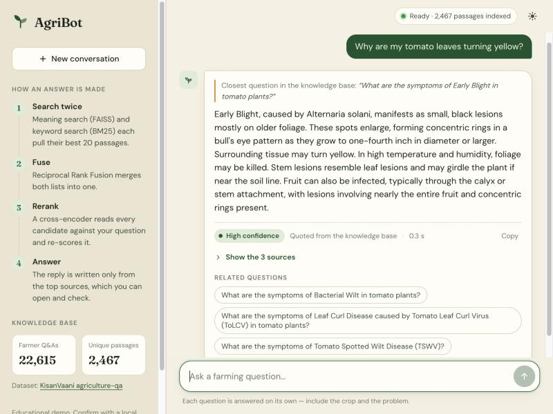
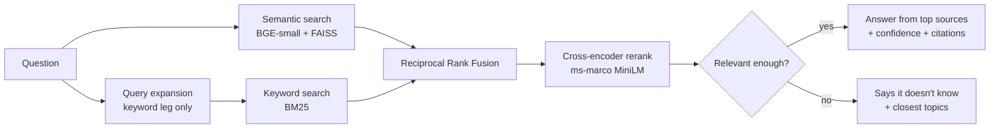

# AgriBot — Agriculture RAG Chatbot

Ask a farming question and get an answer grounded in a knowledge base of
agriculture Q&As, with the sources shown next to it.

AgriBot is a Retrieval-Augmented Generation (RAG) project in two parts:

- **A web app** (FastAPI + a hand-written frontend) small enough to run on a
  free 512 MB hosting instance.
- **A research notebook** that builds the pipeline from scratch and evaluates
  each stage (chunking, embedding models, FAISS index types, fusion, reranking,
  cross-encoder fine-tuning, and generation).



## How an answer is made



1. **Search twice.** The question is embedded with `BAAI/bge-small-en-v1.5` and
   matched against a FAISS index; in parallel BM25 does a keyword search.
2. **Fuse.** Reciprocal Rank Fusion merges the two ranked lists.
3. **Rerank.** `cross-encoder/ms-marco-MiniLM-L-6-v2` reads each candidate
   together with the question and re-scores it. The best score, squashed to
   0–1, becomes the confidence shown in the UI.
4. **Answer.** The reply is written only from the top sources. If nothing in
   the knowledge base is relevant, AgriBot says so instead of guessing.

The knowledge base is the
[KisanVaani/agriculture-qa-english-only](https://huggingface.co/datasets/KisanVaani/agriculture-qa-english-only)
dataset: 22,615 rows, which de-duplicate to 2,467 unique passages.

## Run it locally

Requires Python 3.12 or newer (3.12 is what it is tested and deployed with).

```bash
git clone https://github.com/Prathameshkadam1998/agriculture-rag-chatbot.git
cd agriculture-rag-chatbot

python3.12 -m venv .venv
source .venv/bin/activate          # Windows: .venv\Scripts\activate
pip install -r requirements.txt

uvicorn app.main:app --reload
```

Open <http://localhost:8000>. The first start downloads two small ONNX models
(about 56 MB in total); the search index is already in the repository under
`data/index/`.

In VS Code: open the folder, pick `.venv` as the interpreter
(**Python: Select Interpreter**), and run the same commands in the integrated
terminal.

## Answer writers

| `GENERATOR` | What it does | Needs |
| --- | --- | --- |
| `extractive` | Quotes the best-matching answer from the knowledge base. Cannot hallucinate. | Nothing |
| `llm` | Sends the top sources to an OpenAI-compatible chat API and asks it to write a cited answer from them only. | `LLM_API_KEY`, `LLM_MODEL` |
| `auto` (default) | `llm` when a key and model are configured, otherwise `extractive`. | — |

If the LLM call fails for any reason, that one answer falls back to
`extractive`, so the chatbot never goes down because a provider did.

To turn on written answers, set three environment variables (see
[`.env.example`](.env.example)). Any OpenAI-compatible provider works — for
example Groq, OpenRouter, or a local Ollama server:

```bash
export LLM_BASE_URL=https://api.groq.com/openai/v1
export LLM_API_KEY=your-key
export LLM_MODEL=a-chat-model-your-provider-offers
```

## Configuration

All settings are optional environment variables.

| Variable | Default | Purpose |
| --- | --- | --- |
| `GENERATOR` | `auto` | Answer writer: `auto`, `extractive`, or `llm` |
| `LLM_BASE_URL` | `https://api.groq.com/openai/v1` | OpenAI-compatible endpoint |
| `LLM_API_KEY` / `LLM_MODEL` | unset | Credentials and model for the `llm` writer |
| `RERANK_POOL` | `20` | Candidates the cross-encoder re-scores. Lower is faster on a slow CPU |
| `ONNX_THREADS` | `1` | CPU threads per model |
| `RATE_LIMIT_PER_MINUTE` | `30` | Questions per client per minute (`0` disables) |
| `MODEL_CACHE_DIR` | Hugging Face cache | Where the ONNX models are stored |
| `INDEX_DIR` | `data/index` | Location of the pre-built index |

Retrieval and confidence thresholds live in [`src/config.py`](src/config.py).

## Deploy for free on Render

The app is sized for [Render](https://render.com)'s free web service
(512 MB RAM, 0.1 CPU). The repository includes a [`render.yaml`](render.yaml)
Blueprint, so deployment is a few clicks:

1. Push this repository to GitHub.
2. In the Render dashboard choose **New → Blueprint** and select the repository.
3. Render reads `render.yaml`, installs `requirements.txt`, downloads the models
   during the build, and starts the server. No environment variables are
   required.
4. Optional: add `LLM_API_KEY` and `LLM_MODEL` under **Environment** to switch
   from quoted to written answers.

What to expect on the free plan:

- The service **sleeps after 15 minutes without traffic** and takes about a
  minute to wake up on the next visit.
- With a tenth of a CPU, an answer takes a few seconds rather than the ~0.2 s
  measured on a laptop. `render.yaml` lowers `RERANK_POOL` to 12 to help.
- Memory: the server measured about 250 MB on macOS after 150 questions. Linux
  numbers can differ, so check the Render metrics tab after the first deploy.

Why not Hugging Face Spaces? It would be the natural home for an ML demo, but
its documentation now says Gradio and Docker Spaces require a paid plan to
create, so it no longer meets the "free" requirement.

### Other hosts

A [`Dockerfile`](Dockerfile) is included for any container host (Cloud Run,
Fly.io, a VPS, a paid Space). It bakes the models into the image and listens on
`$PORT` (default 10000):

```bash
docker build -t agribot .
docker run -p 10000:10000 agribot
```

## API

| Method | Path | Description |
| --- | --- | --- |
| `POST` | `/api/chat` | Body `{"question": "..."}` (max 400 characters). Returns the answer, confidence, sources, related questions, and timings |
| `GET` | `/api/info` | Knowledge-base stats and example questions for the UI |
| `GET` | `/api/health` | Health check |
| `GET` | `/api/docs` | Interactive OpenAPI documentation |

```bash
curl -s localhost:8000/api/chat \
  -H 'content-type: application/json' \
  -d '{"question": "When is the best time to plant cassava?"}'
```

```json
{
  "answer": "It is recommended to plant cassava at the beginning of the rainy season when there is enough moisture in the soil.",
  "kind": "answer",
  "confidence": {"label": "High", "score": 0.9994},
  "sources": [{"id": 0, "question": "...", "answer": "...", "relevance": 0.9994}],
  "related": ["..."],
  "generator": "extractive",
  "timings_ms": {"retrieval": 258, "generation": 0, "total": 259}
}
```

`kind` is `answer`, `no_match` (nothing relevant in the knowledge base), or
`greeting`.

## Project structure

```text
agriculture-rag-chatbot/
├── app/                      # Web service
│   ├── main.py               # FastAPI routes, validation, rate limiting
│   ├── engine.py             # Loads index + models, answers questions
│   └── settings.py           # Environment-variable settings
├── frontend/                 # Static UI (no build step)
│   ├── index.html
│   ├── styles.css
│   └── app.js
├── src/                      # RAG library, shared by the app and the notebook
│   ├── config.py             # Models, chunking, retrieval and threshold settings
│   ├── data_processing.py    # Cleaning, chunking, BM25 tokenisation
│   ├── retrieval.py          # FAISS, BM25, Reciprocal Rank Fusion
│   ├── pipeline.py           # Retrieval pipelines (hybrid, semantic-only, blended)
│   ├── embeddings.py         # ONNX embedder and reranker
│   ├── generation.py         # Extractive and LLM answer writers
│   └── index_store.py        # Save / load the pre-built index
├── scripts/
│   ├── build_index.py        # Dataset → data/index
│   ├── download_models.py    # Pre-download ONNX models at build time
│   └── clean_notebook_metadata.py
├── data/index/               # Pre-built index (embeddings, chunks, manifest)
├── notebooks/
│   └── 00_agriculture_rag_from_scratch.ipynb
├── tests/
├── Dockerfile
├── render.yaml
├── requirements.txt          # Web app only (no PyTorch)
└── requirements-dev.txt      # + index building, tests, notebook
```

## Development

```bash
pip install -r requirements-dev.txt

pytest                              # 32 tests, no downloads needed
ruff check .

python -m scripts.build_index       # rebuild data/index from the dataset
```

The tests use a small in-memory corpus and fake models, so they run offline in
a few seconds.

### Why ONNX instead of PyTorch in the app

The notebook uses Sentence Transformers on PyTorch. PyTorch alone is larger than
a free instance's memory, so the app runs int8-quantised ONNX exports of the
same two models on `onnxruntime`. `src/embeddings.py` exposes them with the same
`encode` / `predict` interface, which is why `src/pipeline.py` works unchanged
with either backend.

## Research notebook

[`notebooks/00_agriculture_rag_from_scratch.ipynb`](notebooks/00_agriculture_rag_from_scratch.ipynb)
walks through the whole pipeline and its evaluation: three chunking strategies,
an embedding-model comparison, FAISS index types, four retrieval variants scored
with Recall@K, Precision@K, MRR and NDCG, cross-encoder fine-tuning, and answer
generation with Flan-T5 scored with ROUGE and BERTScore.

It is written for Google Colab. Install `requirements-dev.txt` to run it
elsewhere. On Apple Silicon, the `faiss-cpu` and `torch` wheels each bundle
their own OpenMP runtime and crash when loaded into one process, so use Colab or
Linux for the notebook. The web app is not affected because it does not use
PyTorch.

## Limitations

- **It only knows its dataset.** Coverage is strongest for maize, cassava,
  beans, tomato, mango and general soil and pest topics. Questions outside it
  get an honest "I couldn't find that".
- **Each question is answered on its own.** There is no conversation memory, so
  include the crop and the problem in every question.
- **English only.**
- **Not professional advice.** This is an educational project. Confirm with a
  local agricultural extension officer before applying any chemical or changing
  a treatment.

## Acknowledgements

Dataset: [KisanVaani/agriculture-qa-english-only](https://huggingface.co/datasets/KisanVaani/agriculture-qa-english-only).
Models: [BAAI/bge-small-en-v1.5](https://huggingface.co/BAAI/bge-small-en-v1.5)
and [cross-encoder/ms-marco-MiniLM-L-6-v2](https://huggingface.co/cross-encoder/ms-marco-MiniLM-L-6-v2),
served from their ONNX exports by Xenova.
